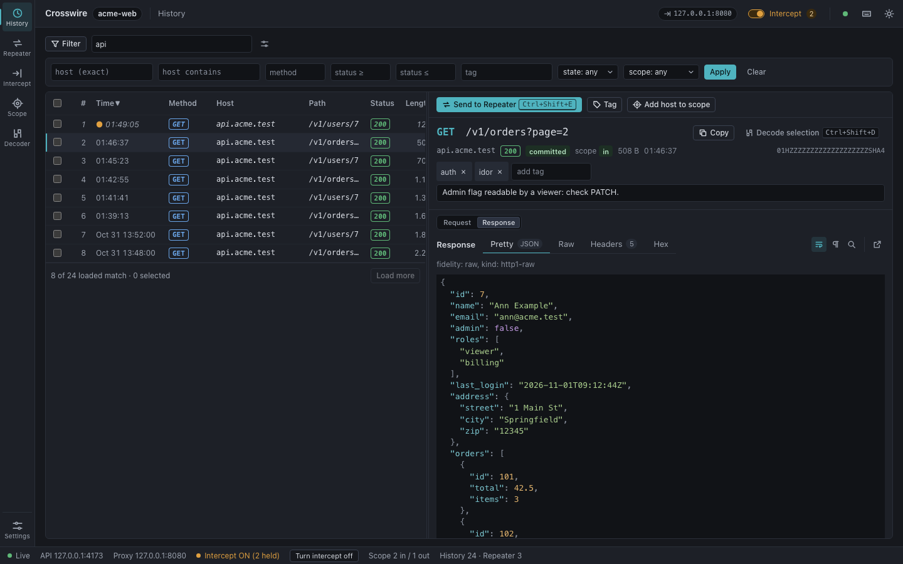

# Crosswire

**The wire-exact web security proxy, in Rust. What you send is what goes on the wire; what you record is what came back, byte for byte.**

[](https://github.com/kalash33/crosswire/actions/workflows/ci.yml)
[](#licence)
[](Cargo.toml)
[](https://github.com/kalash33/crosswire/releases)

Crosswire is an open-source web application security testing proxy for
authorised testing. It is an HTTP/1.1 intercepting (MITM) proxy that records
every exchange into a crash-safe project, byte for byte, with the web UI embedded
in one binary: a history with Pretty, Raw, Headers and Hex views, a repeater
with send history and response diff, request intercept, scope rules, a decoder,
tags and notes. It is built on a byte-exact HTTP stack, so malformed and
ambiguous HTTP is kept and sent as it is, with every deviation recorded as a
diagnostic. It does **not** yet do HTTP/2, Intruder-style fuzzing, response
intercept, match-and-replace or extensions; see the [roadmap](#project-status-and-roadmap).
It is a pure community project: no company behind it, nothing gated.



Coming from Burp Suite? Start with [Coming from Burp](docs/coming-from-burp.md).

## Install

The package is `crosswire-server`; the binary it installs is `crosswire`.

Pick one. Release binaries are built for `x86_64-unknown-linux-gnu`,
`aarch64-unknown-linux-gnu` and `aarch64-apple-darwin` (glibc builds; a fully
static musl build and binstall signature verification are 0.1.x follow-ups,
provenance is covered by the attestations below).

1. **cargo binstall** (downloads the release binary instead of compiling):

   ```
   cargo binstall crosswire-server --git https://github.com/kalash33/crosswire
   ```

   With `--git`, binstall installs the version named in the default branch's
   manifest (pre-release or not) and downloads that release's archive; it
   cannot select an older release.

2. **Shell installer** (generated by cargo-dist):

   ```
   curl --proto '=https' --tlsv1.2 -LsSf https://github.com/kalash33/crosswire/releases/latest/download/crosswire-server-installer.sh | sh
   ```

   `latest` resolves only to a full release. To install a pre-release, replace
   `latest/download` with `download/<tag>` (for example `download/v0.1.0-rc.2`).

3. **Tarball.** Download `crosswire-server-<target>.tar.xz` from the
   [releases page](https://github.com/kalash33/crosswire/releases) for your
   target, then verify it:

   ```
   gh attestation verify crosswire-server-<target>.tar.xz --repo kalash33/crosswire
   ```

4. **From source** (needs Rust 1.88 or newer only; the web UI is already
   embedded, so Node is not required):

   ```
   cargo install --git https://github.com/kalash33/crosswire crosswire-server --locked
   ```

## Quick start

One command starts the proxy, opens the UI in its own window and launches a
Chromium-based browser (Chrome, Chromium, Edge or Brave) already wired to the
proxy, with a dedicated profile and no system trust change:

```sh
crosswire app --project ./demo
```

Browse in the wired browser and the traffic appears in History. Ctrl-C stops the
proxy, the UI window and the browser, and closes the project cleanly.

### The manual path

`crosswire app` is `serve --open=app` plus `crosswire browser`. To run the
pieces yourself:

```sh
crosswire serve --project ./demo --open
```

```
proxy listening on 127.0.0.1:8080
ca page at http://crosswire/ (via the proxy) or http://127.0.0.1:8080/
api listening on 127.0.0.1:8081
open http://localhost:8081/#bootstrap=<token> within 60 s
```

`--open` opens that one-time bootstrap URL in your default browser (`--open=app`
uses a standalone Chromium app window); without it, open the URL yourself within
60 seconds. Then launch a browser wired to the proxy (`--proxy` is needed while
`serve` is running):

```sh
crosswire browser --project ./demo --proxy 127.0.0.1:8080
```

To use your own browser instead, point its HTTP and HTTPS proxy at
`127.0.0.1:8080` and trust the CA: open `http://crosswire/` through the proxy,
download `/ca.der` or `/ca.pem`, or launch Chrome or Chromium with the CA's pin:

```sh
--proxy-server=127.0.0.1:8080 \
--ignore-certificate-errors-spki-list=$(crosswire ca spki)
```

Per-browser and per-OS instructions, including Firefox, Android and iOS, are in
[docs/ca-install.md](docs/ca-install.md); every `serve` option is in
[the server README](crates/crosswire-server/README.md).

### Calling the API

The API is a second socket, separate from the proxy. The `open ...` line carries
a single-use bootstrap token (valid for 60 seconds, printed once). Exchange it
for a session cookie, then call the API; a cookie request needs a same-origin
header, which `curl` does not send on its own:

```sh
TOKEN=...   # the part after #bootstrap=
curl -si -c jar -X POST http://localhost:8081/api/v1/session \
  -H 'content-type: application/json' -d "{\"bootstrap\":\"$TOKEN\"}"

curl -s -b jar -H 'Sec-Fetch-Site: same-origin' \
  'http://localhost:8081/api/v1/exchanges?limit=10'
```

For scripts, mint a scoped token instead (`crosswire token create --project
./demo --name ci --scopes read,send`, with `serve` stopped) and send it as
`Authorization: Bearer cwt_...`. Tokens are `read`, `send` or `admin`, stored
only as a hash. The whole guide, with scope, repeater, intercept and the event
stream, is [docs/api.md](docs/api.md); the credential design is
[ADR-0004](docs/adr/0004-api-credentials.md).

## Features

| Area | What it does | Status |
|---|---|---|
| HTTP/1.1 MITM proxy | Byte-for-byte relay on both sides, keep-alive, pipelining, chunked with extensions and trailers; TLS termination with per-host leaves from a local CA; SNI passthrough per host or suffix | Shipped |
| Byte-exact history | Every exchange with timing, TLS details, diagnostics with byte spans, interim 1xx heads and bodies up to a capture cap (full hash and length kept); crash-safe SQLite project store with gap markers and an audit log | Shipped |
| Message viewer | Pretty (JSON and form or query parameters as tables), Raw (coloured heads, line wrap, visible control characters, find), Headers and Hex tabs; large bodies bounded | Shipped |
| History tools | Search, filters, column picker, bulk tag and add-to-scope, tags and notes, copy as curl, copy raw | Shipped |
| Repeater | Raw and assisted modes, scope checks, redirects, saved drafts, per-tab send history (last 50), restore a past send, "Compare with previous" line diff, renamable tabs | Shipped |
| Request intercept | Hold, edit and forward, drop, forward-all, skip rules, hold limits and an overflow policy; starts disabled | Shipped |
| Scope | Include and exclude rules (host, suffix, regex, IP, CIDR, port, scheme, path), a verdict on every exchange, pasted program lists imported, optional strict enforcement | Shipped |
| Decoder | Decode the selected message in its own pane or route | Shipped |
| Browser launcher | `crosswire browser` and `crosswire app`: Chrome, Chromium, Edge or Brave with a dedicated profile | Shipped |
| Web UI | Embedded in the binary; dark and light themes, remappable shortcuts, installable as its own window | Shipped |
| REST and WebSocket API | Own loopback socket, bootstrap session and scoped tokens, OpenAPI document | Shipped |
| Response intercept | Hold and edit responses | Not yet (0.2) |
| Match-and-replace | Rules applied to traffic | Not yet (0.2) |
| Intruder | Positions, payloads, attacks | Not yet (0.2) |
| HTTP/2 and WebSocket editing | Proxying and editing | Not yet (spec section 14) |
| Extensions and plugins | | Not yet |
| Team mode | Free self-hosted team mode | Not yet (spec section 14) |

## Security model

A security tool has to be safe to run. The design is in
[the spec](docs/superpowers/specs/2026-10-22-crosswire-design.md) section 11;
each gate and the test that proves it is in
[docs/security-gates.md](docs/security-gates.md).

- **Loopback-only API.** The API listens on its own loopback socket. A
  single-use, 60-second bootstrap token is exchanged for a `SameSite=Strict`
  session cookie; scripts use `read`, `send` or `admin` tokens stored only as a
  hash. Requests must be same-origin with a `localhost` or `127.0.0.1` `Host`;
  no CORS header is ever sent; authentication failures are rate-limited and
  audited.
- **Destination gate (SSRF).** After DNS resolution, the proxy and repeater
  refuse loopback, link-local, cloud-metadata, unspecified, multicast and
  broadcast addresses and Crosswire's own ports, including IPv6 transition
  forms. `--allow HOST:PORT` lifts only the loopback and link-local refusals,
  and each allowance is audited.
- **Untrusted content is never trusted.** Captured traffic is attacker-controlled.
  The UI renders it as text under fixed rules, and the HTML preview runs in a
  sandboxed frame under a deny-all CSP that cannot make a network request.
- **Hostile projects are refused.** The project store validates what it opens
  (torn packs, decompression bombs, hostile SQLite or journal files, symlinked
  project files) and refuses a project it cannot trust.
- **Redaction on copy and export.** Share-safe copy and export variants redact
  secrets; the plain copy shortcuts keep the data so a request can be replayed.
- **The CA key is never exposed.** The API and the CA page serve the
  certificate only; the private key stays in your config directory.
- **Idle means silent.** An idle Crosswire makes no upstream connection and no
  DNS lookup.

Crosswire is for authorised testing only. Point it at systems you own or have
written permission to test.

## Project status and roadmap

**Status: v0.1.0.** The wire format and project format are frozen for the 0.1
series, the release pipeline is in place (attested binaries for three targets),
and the section 13 security gates each map to a named test
([docs/security-gates.md](docs/security-gates.md)). Two performance targets (ingest
rate and History table speed at a million rows) are report-only in 0.1.0 and are
the main 0.1.x work. See [CHANGELOG.md](CHANGELOG.md).

| Milestone | Contents |
|---|---|
| **0.1.0** | HTTP/1.1 proxy, byte-exact history, repeater, intercept, scope, decoder, embedded web UI, attested releases |
| **0.1.x** | Virtualised History table, faster ingest, release hardening |
| **0.2** | Response intercept, match-and-replace, Intruder, crates.io publishing |
| Later | HTTP/2, WebSocket editing, plugins, free self-hosted team mode, HTTP/3 |

The full design, including the honest competitive picture and dated estimates,
is in [the spec](docs/superpowers/specs/2026-10-22-crosswire-design.md), section 14.

## Architecture

```
            browser ──► crosswire-proxy ──► crosswire-client ──► target
                         │  (MITM, relay)      (gate, TLS)
                         │
                         ▼  ExchangeSink
                       crosswire-store  (SQLite + packs + journal + audit)

   crosswire-scope  scope rules, evaluator, program-list importer
   crosswire-tools  repeater
   crosswire-api    REST + WebSocket API, credentials (own loopback socket)
   crosswire-h1     sans-IO HTTP/1 parser and byte-exact writer
   crosswire-model  frozen exchange schema, events, redaction
   crosswire-ca     local CA and cached leaf issuer
   crosswire-core   spans, diagnostics, shared types
   crosswire-server the `crosswire` binary (`serve`, `app`, `token`, `browser`, `ca`)
```

| Crate | Responsibility | Docs |
|---|---|---|
| `crosswire-core` | Byte spans, the 26-code diagnostic catalogue, shared types; `no_std` + `alloc` | [README](crates/crosswire-core/README.md) |
| `crosswire-h1` | Sans-IO HTTP/1 parsing and byte-exact writing with spans and diagnostics for every element | [README](crates/crosswire-h1/README.md), [catalogue](docs/h1-diagnostics.md), [ADR-0001](docs/adr/0001-h1-sans-io-contract.md) |
| `crosswire-model` | The exchange schema, `ExchangeSink`, redaction on the way out | [README](crates/crosswire-model/README.md) |
| `crosswire-ca` | P-256 CA, file key store, rate-limited leaf issuer | [README](crates/crosswire-ca/README.md) |
| `crosswire-client` | Recording upstream HTTP/1.1 client, destination gate, rustls backend | [README](crates/crosswire-client/README.md) |
| `crosswire-store` | Crash-safe project store | [README](crates/crosswire-store/README.md), [ADR-0002](docs/adr/0002-store-durability.md), [format](docs/format.md) |
| `crosswire-proxy` | HTTP/1.1 MITM proxy engine | [README](crates/crosswire-proxy/README.md), [ADR-0003](docs/adr/0003-proxy-relay.md) |
| `crosswire-scope` | Scope rule grammar, evaluator and importer | [README](crates/crosswire-scope/README.md) |
| `crosswire-tools` | The repeater | [README](crates/crosswire-tools/README.md) |
| `crosswire-api` | The REST and WebSocket API and its credentials | [README](crates/crosswire-api/README.md), [guide](docs/api.md), [ADR-0004](docs/adr/0004-api-credentials.md), [OpenAPI](docs/api/openapi.json) |
| `crosswire-server` | The `crosswire` binary: `serve`, `app`, `token`, `browser`, `ca` | [README](crates/crosswire-server/README.md) |

`corpus/h1` holds the golden fidelity corpus ([README](corpus/h1/README.md));
`crates/crosswire-recorder-tests` holds cross-crate integration tests.

## Developing

Commands live in the `justfile`:

| Command | What it does |
|---|---|
| `just test` | All tests, all features |
| `just lint` | Clippy with `-D warnings` and `cargo fmt --check` |
| `just features` | `cargo check` with no default features and each feature alone |
| `just browser-test` | A headless Chromium session through the proxy (set `CROSSWIRE_BROWSER` or have `google-chrome` on `PATH`) |
| `just fuzz-smoke` | 60 s of each h1 fuzz target (nightly + `cargo-fuzz`) |
| `just bench` | Builds the h1 vs `httparse` criterion benchmark |
| `just first-capture` | Builds, serves, drives a headless browser to `https://example.com/` and times the first recorded exchange (needs network and a Chromium-based browser) |
| `just serve --project ./demo` | `crosswire serve` on a demo project |

CI runs lint, tests, feature checks, docs, packaging and the browser session on
Ubuntu and macOS, plus an MSRV 1.88 check and `cargo deny`. Design decisions
are recorded in [docs/adr/](docs/adr/); the on-disk project format in
[docs/format.md](docs/format.md); the tests behind each security gate in
[docs/security-gates.md](docs/security-gates.md); the velocity log in
[docs/log.md](docs/log.md).

## Contributing, governance and security

Contributions are welcome in the areas listed in
[CONTRIBUTING.md](CONTRIBUTING.md) (DCO sign-off, the AI-assisted-PR rule,
which crates are design-locked until their 0.1 release). Report security
issues privately as described in [SECURITY.md](SECURITY.md) (72-hour
acknowledgement). The project follows the Contributor Covenant
([CODE_OF_CONDUCT.md](CODE_OF_CONDUCT.md)). How decisions are made is in
[GOVERNANCE.md](GOVERNANCE.md).

Crosswire is for authorised testing only. Point it at systems you own or have
written permission to test.

## Licence

Licensed under either of Apache-2.0 ([LICENSE-APACHE](LICENSE-APACHE)) or MIT
([LICENSE-MIT](LICENSE-MIT)) at your option.
